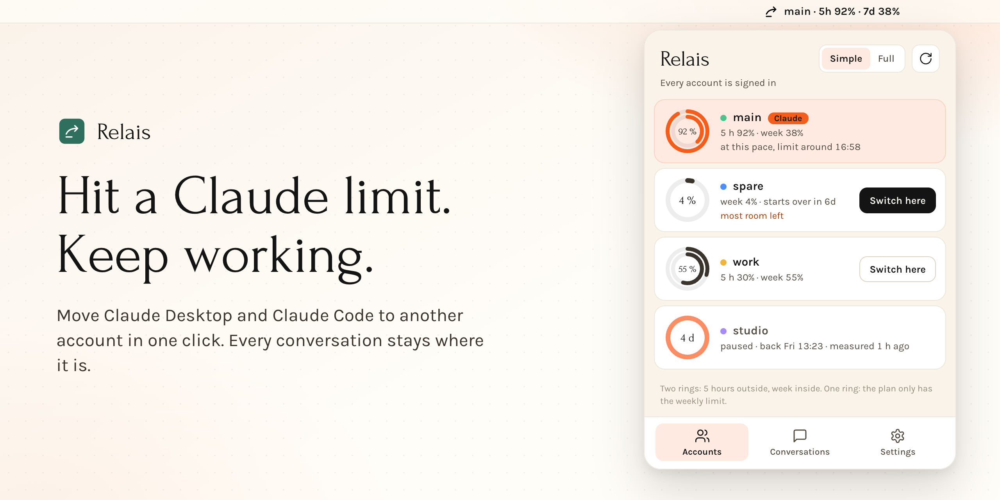
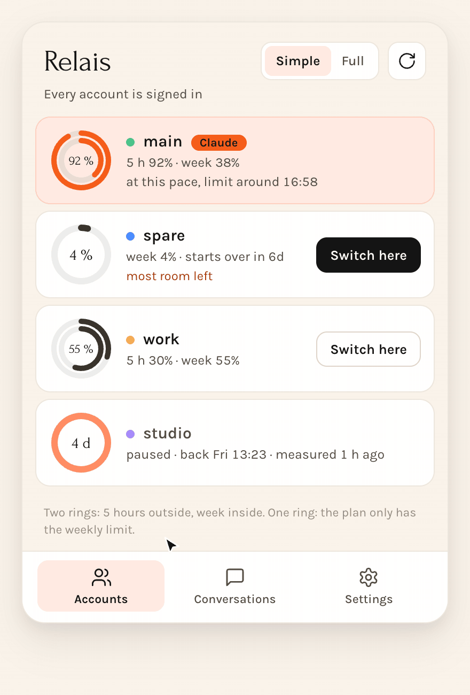
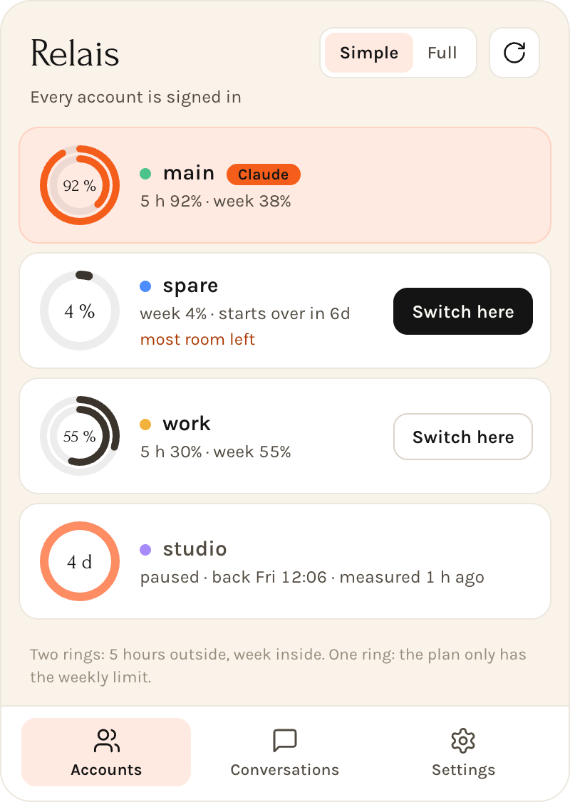
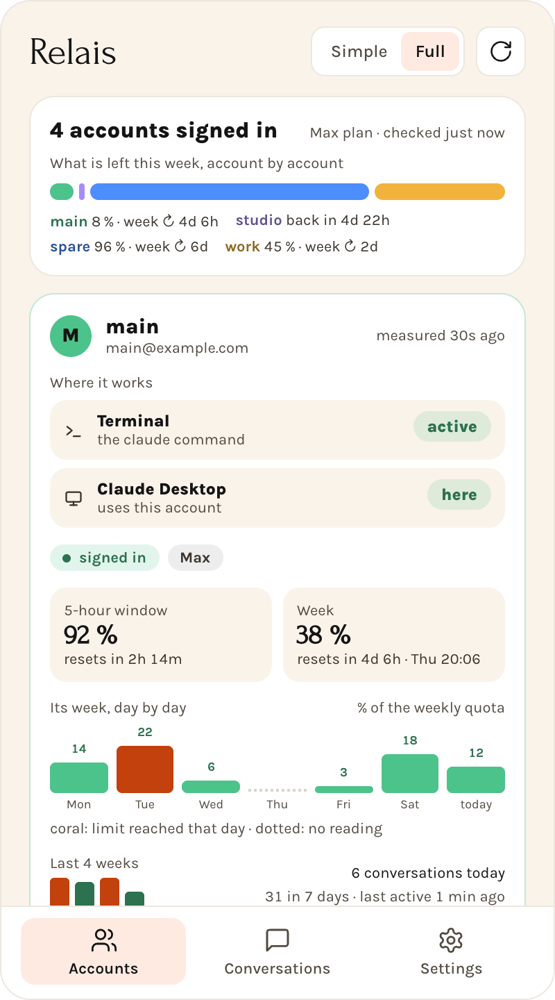
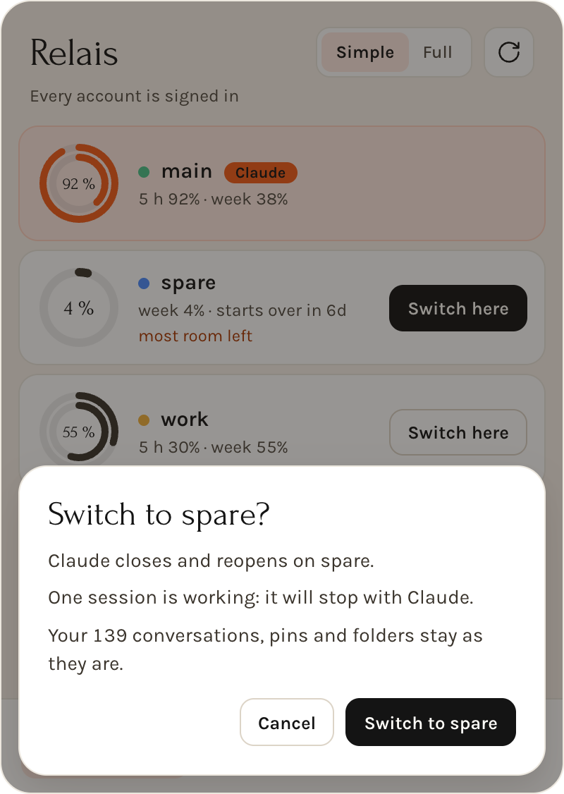
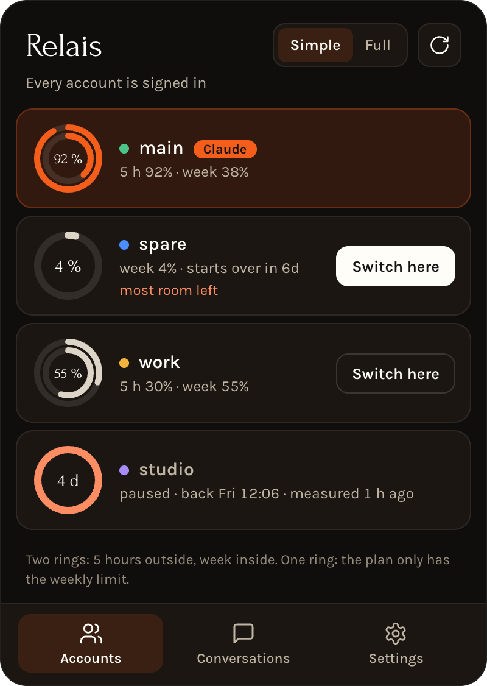
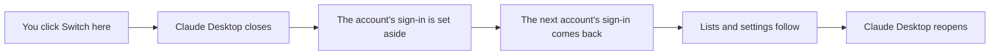

<p align="center">
  
</p>

# Relais: switch Claude accounts on your Mac and keep everything

**Relais is a free, open-source Claude account switcher for macOS.** When one Claude subscription hits its usage limit, one click moves Claude Desktop and Claude Code to another account, and Desktop comes back exactly as you left it: the same conversations, pins, folders and settings.

<p align="center">
  <a href="LICENSE"></a>
  
  
  <a href="https://github.com/bvisible/relais/releases/latest"></a>
  <a href="https://bvisible.github.io/relais/"></a>
</p>

<p align="center">
  
</p>

## Why Relais

If you run several Claude accounts on one Mac (Claude Pro, Claude Max, a work account), reaching a limit normally costs you your place. Claude Desktop files its conversation list, pins and folders under the signed-in account, so signing in to another one shows you a different workspace.

Relais keeps one workspace and changes only the sign-in:

- **Everything stays.** Conversations, pinned items, folder order, sidebar sections, permissions and session presets follow you to the next account.
- **You see every limit at a glance.** Each account shows its 5-hour and weekly usage as rings, and when it comes back if it is paused. Plans without the 5-hour limit show the week alone.
- **It tells you where to go.** The account with the most room left is marked. Relais suggests, you decide: it never switches on its own.
- **Your credentials stay yours.** Relais never reads, copies or stores a token, a cookie or a password.

## Screenshots

<table>
  <tr>
    <td width="50%" valign="top"><br><strong>Simple view.</strong> Every account on one line, one button to switch.</td>
    <td width="50%" valign="top"><br><strong>Full view.</strong> One switch away: where each account works, its limits and its week day by day.</td>
  </tr>
  <tr>
    <td width="50%" valign="top"><br><strong>A switch is always confirmed.</strong> You see what happens, which sessions are still working and what stays.</td>
    <td width="50%" valign="top"><br><strong>Follows your Mac.</strong> Light and dark, in English and in French.</td>
  </tr>
</table>

## How a switch works



**Claude Desktop: one workspace, the sign-in changes.** Desktop's data folder holds your whole workspace, and only four files in it make it signed in as one account. With Desktop closed, Relais renames those files aside, puts the next account's back, and carries to it what Desktop files under an account's id. Each step is journaled and backed up first: a step that fails undoes the switch at once, and a switch cut short is undone by the next run.

**Claude Code in the terminal: one profile per account.** Each account has its own `CLAUDE_CONFIG_DIR`. Transcripts, settings, skills and MCP servers are shared between profiles, and the parts of `.claude.json` not tied to an account stay in sync. New terminals follow the switch, and open ones keep their account.

More detail in the [design document](docs/design.md).

## Your credentials stay with Anthropic

Relais does not read, copy, refresh or store any OAuth token, session cookie or Keychain secret. You sign in through Anthropic's own apps, they keep and refresh their logins as usual, and Relais only moves Desktop's sign-in files aside and back by renaming them, without opening them. That removes the whole class of "dead token" bugs that tools copying tokens have to chase.

Relais makes no call to Anthropic either. Usage comes from what Claude Code hands to its status line, from the history the desktop app keeps, and from Claude Code's own `/usage` panel: every quarter of an hour the app opens the official client in a private terminal, with nothing of yours loaded, reads the panel and closes it. No prompt is sent, nothing is billed and no conversation is saved.

## Install

**[Download Relais for Mac](https://github.com/bvisible/relais/releases/latest)**, open the DMG and drag Relais to Applications. It needs macOS 13 or later on Apple Silicon, and is tested on macOS 26 and 27. The app is signed with a Developer ID and notarized by Apple, so macOS opens it without a warning. There are no automatic updates yet: download new versions from the same page.

Link the command that comes with the app and register the account you are signed in with:

```bash
mkdir -p ~/.local/bin
ln -s /Applications/Relais.app/Contents/MacOS/relais ~/.local/bin/relais
relais init
```

Add your other accounts, each signing in through Anthropic's own flow:

```bash
relais account add me@work.example  # signs in in its own Chrome profile
relais statusline-install           # record usage, and which account runs each session
relais shell-install                # make `claude` run with the active account
```

If the panel says measuring waits for your OK, click **Allow**: Claude Code asks its first-run questions once, and Relais never answers them for you.

### Build from source

You need [Rust](https://rustup.rs), [Node.js](https://nodejs.org), [pnpm](https://pnpm.io) and Xcode's command line tools.

```bash
git clone https://github.com/bvisible/relais.git
cd relais
pnpm --dir app install
./app/scripts/build-macos.sh
cp -R target/release/bundle/macos/Relais.app /Applications/
```

## Commands

The menu bar app and the `relais` command do the same work.

```bash
relais list                     # every account, its usage and how long until each reset
relais desktop work --dry-run   # what switching Claude Desktop to work would do
relais desktop work             # do it: Desktop closes, reopens on work, new terminals follow
relais desktop --bring-back     # Desktop closed: put back the conversations a switch set aside
relais switch next              # move only the terminal: a name, next, prev or best
relais continue                 # carry the latest conversation over to the active account
relais allow-measure            # answer, once, what Claude Code asks before Relais can measure
relais doctor                   # check sign-ins, links and integrations
```

## FAQ

### How do I switch between Claude accounts on a Mac?

Open the Relais panel in the menu bar and click **Switch here** next to the account you want. Claude Desktop closes and reopens on that account, and new terminals follow. From the terminal, `relais desktop <account>` does the same.

### Can I use several Claude subscriptions on the same Mac?

Yes. Each account signs in once through Anthropic's own flow, and Relais keeps track of which one Claude Desktop and your terminals use.

### Will I lose my conversations when I change Claude account?

No. Your local Claude Code and Cowork sessions, pins and folders stay in the same workspace. If the arriving account has conversations of its own, Relais asks whether to add them to your list or set them aside, and `relais desktop --bring-back` returns what was set aside. The Chat tab and cloud sessions live on Anthropic's servers under each account, so they do not move.

### Does Relais see my Claude password or token?

No. It never opens them. The only thing it reads from a sign-in file is the account's id, which is not a secret, to know whose sign-in it is.

### How does Relais know how much of my Claude limit is left?

It reads the figures Claude Code already gives its status line, the history Claude Desktop keeps, and the official `/usage` panel every quarter of an hour. A reading that stops updating says how old it is, and the advice ignores it once it is too old to go by.

### Does it switch automatically when I hit the limit?

No. A ring turns orange as an account fills up and Relais marks the one with the most room left, but the switch is yours.

### Can Relais switch accounts without closing Claude Desktop?

No. Desktop has to restart on the other sign-in, so sessions working inside it stop, and the confirmation tells you how many. Sessions in terminals you already opened keep running on their account.

### Which Claude plans does it work with?

It is developed and used daily on Claude Max accounts, with or without the 5-hour limit, on Claude Desktop 3.6556 and Claude Code 2.1.314. Other plans should behave the same: please [open an issue](https://github.com/bvisible/relais/issues) if yours does not. A Claude update can change what Relais relies on.

### Does Relais work on Windows, Linux or Intel Macs?

Not for now. The download is for Macs with Apple Silicon, and Relais lives in the macOS menu bar.

### Is the Relais app signed and notarized?

Yes. Each release is signed with a Developer ID and notarized by Apple, and its SHA-256 sum is published next to the download.

### What about Claude in Chrome?

It is out of scope: its sign-in lives in the browser.

### Is Relais made by Anthropic?

No. Relais is an independent project, not affiliated with or endorsed by Anthropic. You remain responsible for using your subscriptions within Anthropic's terms.

## Status

Relais is in early development, used daily on one Mac, where a real switch between two accounts kept every conversation, pin and folder. Issues and ideas are welcome.

| Part | State |
|---|---|
| Account registry, shared config sync, usage readings, conversation index | done, tested |
| Terminal: `relais` command | done, tested, in daily use |
| Claude Desktop switch that keeps the workspace | done, tested, used for real |
| Menu bar app (Tauri, React) with a simple and a full view | done, tested |

To work on it, see [`app/`](app) and [`crates/`](crates). `cargo test` and `pnpm --dir app test` run everything, on made-up accounts. The images above come from `app/scripts/capture.mjs`, which only ever shows made-up accounts too.

## License

[MIT](LICENSE), by [Neoservice AI](https://neoservice.ai). Claude and Claude Code are trademarks of Anthropic.
